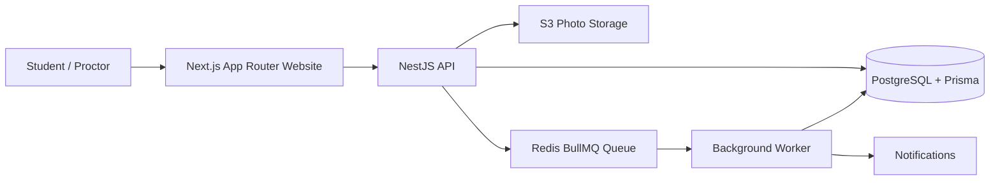
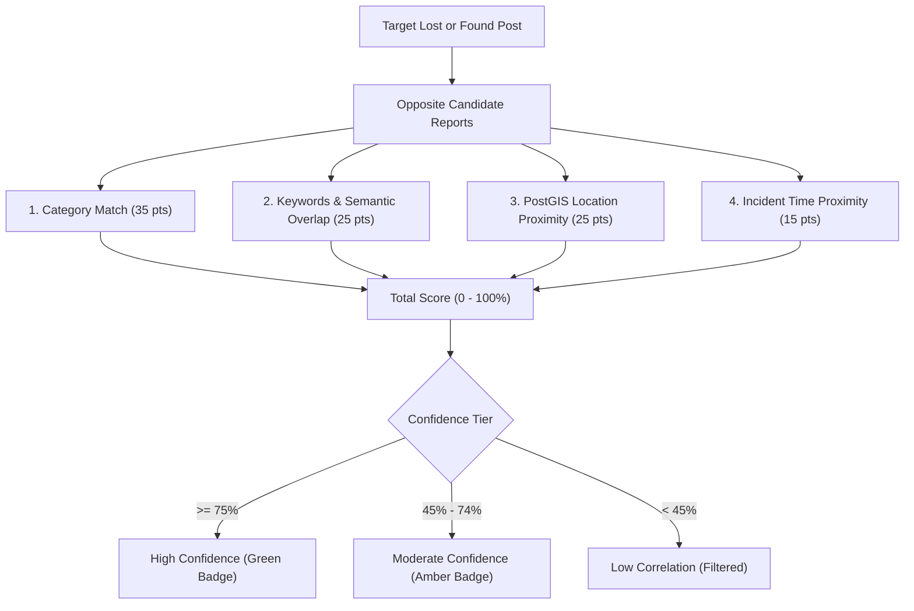

# 🧭 KhojSetu (FoundBeacon)
### Modern TypeScript Full-Stack Campus Lost & Found Bridge

> **Interview Pitch:**
> *"FoundBeacon helps students recover lost items by matching lost and found reports, while keeping identifying details private until ownership is verified."*

---

## 🏛️ System Architecture



### Complete Technology Stack Matrix

| Layer | Technology | Role & Architecture | Documentation |
| :--- | :--- | :--- | :--- |
| **Web App** | **Next.js (App Router), TypeScript, Tailwind CSS** | Server and client components, W3C WCAG 2.2 accessible form controls, real-time match radar, and responsive mobile-first UI. | [Next.js App Router](https://nextjs.org/docs/app) |
| **API** | **NestJS (TypeScript)** | Modular backend organizing Auth, Items, PostGIS Matching, Private Claims, Notifications, and Moderation. | [NestJS Fundamentals](https://docs.nestjs.com/fundamentals.md) |
| **Database** | **PostgreSQL + Prisma ORM** | Schema models for Users, Items, Claims, Notifications, and Audit Logs with relational integrity. | [Prisma with PostgreSQL](https://www.prisma.io/docs/orm/v7/core-concepts/supported-databases/postgresql) |
| **Background Jobs** | **Redis + BullMQ** | Asynchronous workers handling image optimization, pgvector embeddings, and notification dispatching. | [BullMQ Guide](https://docs.bullmq.io/guide/workers) |
| **Photo Storage** | **S3-Compatible Storage (MinIO / AWS S3)** | Uploads kept separate from database; verified with OWASP buffer magic-byte inspection and UUID sanitization. | [OWASP Upload Guidance](https://cheatsheetseries.owasp.org/cheatsheets/File_Upload_Cheat_Sheet.html) |
| **Geospatial & Vectors** | **PostGIS + pgvector** | PostGIS approximate distance ranking on rounded coordinates (~100m) to preserve privacy; optional pgvector semantic search hook. | [PostGIS ST_Distance](https://postgis.net/docs/manual-dev/en/ST_Distance.html) · [pgvector](https://github.com/pgvector/pgvector) |
| **Testing & Tracing** | **Playwright + OpenTelemetry** | Playwright E2E browser automation for the complete claim flow; OpenTelemetry traces HTTP spans and worker queues. | [Playwright](https://playwright.dev/docs/intro) · [OpenTelemetry](https://opentelemetry.io/docs/concepts/signals/) |

---

## 📐 Explainable Match Scoring & PostGIS Proximity

The matching engine ([`matching.service.ts`](file:///d:/KhojSetu/apps/api/src/matches/matching.service.ts)) scores potential matches using a **100-point transparent formula**:



### Point Formula
1. **Category Match (Max 35 points):** Exact match = +35 pts; partial miscellaneous = +10 pts.
2. **Keywords & Semantic Text Overlap (Max 25 points):** Tokenizes title and description (excluding stop-words) for brand, model, color, and object type matches (+8 to +25 pts).
3. **PostGIS Proximity Ranking (Max 25 points):**
   - Coordinates rounded to 3 decimal places (~100m) to guarantee student privacy while enabling spatial queries.
   - Distance $\le 200\text{m}$: **+25 pts** (immediate vicinity / same building).
   - Distance $\le 500\text{m}$: **+18 pts** (same campus quadrant).
   - Distance $\le 1000\text{m}$: **+12 pts** (campus walking radius).
4. **Time Proximity (Max 15 points):**
   - Difference $\le 24\text{ hours}$: **+15 pts**
   - Difference $\le 72\text{ hours}$: **+10 pts**
   - Difference $\le 168\text{ hours}$ (1 week): **+6 pts**

**Plain-Language Output Example:**
> *"Matches because of same category (electronics), matching keywords (blue, dell, dark), reported in close campus proximity (16m away), reported within 2 hours of each other."*

---

## 🔒 Security & Privacy Engineering

### 1. OWASP Secure Object Storage Pipeline
Implements the [OWASP File Upload Cheat Sheet](https://cheatsheetseries.owasp.org/cheatsheets/File_Upload_Cheat_Sheet.html):
- **Buffer Magic-Byte Inspection:** Analyzes raw buffer headers before committing to disk or S3:
  - JPEG: `0xFF, 0xD8, 0xFF`
  - PNG: `0x89, 0x50, 0x4E, 0x47, 0x0D, 0x0A, 0x1A, 0x0A`
  - WebP: `RIFF....WEBP`
  - Malicious files (e.g. PHP scripts disguised as `.jpg`) are immediately rejected.
- **Cryptographic UUID Renaming:** Stored as `${uuidv4()}${safeExt}` to prevent directory traversal (`../`) and shell injection attacks.
- **Strict Size Limit:** 5 MB ceiling strictly enforced.
- **Security Headers:** Served with `X-Content-Type-Options: nosniff`, `Content-Security-Policy: default-src 'none'`.

### 2. Private Ownership Claim Shield
- Public item endpoints **never** expose submitted claim details.
- In `ClaimsService`, `GET /api/claims/item/:id` enforces strict authorization: only the item reporter and campus proctors can view submitted private proof details. Unauthorized students receive `403 Forbidden`.
- When an item claim is approved, the claimant is sent private pickup instructions (e.g. *"Deposited at Library Desk 2 with Ref #502"*), and the item is marked `RETURNED`.

### 3. W3C WCAG 2.2 Form-Label Accessibility
Per [W3C Form Labels Guidance](https://www.w3.org/WAI/WCAG22/Understanding/labels-or-instructions):
- Explicit `<label htmlFor="...">` attributes on all controls.
- Supplementary helper instructions linked using `aria-describedby`.
- Error announcements with `role="alert"`.
- Keyboard navigation (Tab, Enter, Escape modal dismissing) and visible focus rings.

---

## 📦 Monorepo Structure

```
d:/KhojSetu/
├── apps/
│   ├── api/                     # NestJS Backend API
│   │   ├── prisma/              # Prisma schema & seed data
│   │   ├── src/
│   │   │   ├── auth/            # Personas & role guards
│   │   │   ├── items/           # CRUD, PostGIS queries, OWASP upload
│   │   │   ├── matches/         # 100-pt explainable scoring engine
│   │   │   ├── claims/          # Confidential ownership verification shield
│   │   │   ├── moderation/      # Proctor dashboard & audit history
│   │   │   ├── notifications/   # In-app alert feed
│   │   │   ├── queues/          # Redis + BullMQ workers
│   │   │   ├── storage/         # S3 Object Storage + OWASP validation
│   │   │   └── telemetry/       # OpenTelemetry request & worker spans
│   │   └── test/                # Automated integration tests
│   └── web/                     # Next.js App Router Web Application
│       ├── app/                 # Routes: /, /report, /items/[id], /my-posts, /moderator
│       ├── components/          # Navbar, FilterBar, ItemCard, MatchRadar, ClaimModal
│       ├── context/             # AuthContext, NotificationContext
│       └── lib/                 # API client & formatters
├── e2e/                         # Playwright E2E test suite
├── docker-compose.yml           # PostgreSQL, PostGIS, Redis, MinIO, Jaeger
└── package.json                 # Monorepo workspaces
```

---

## ⚡ Quickstart Guide

### 1. Build the Monorepo
```bash
# Typecheck & build NestJS API
npm run build:api

# Build Next.js Web App
npm run build:web
```

### 2. Run NestJS Integration Tests
```bash
npm run test:api
```
*Output: Verifies NestJS compilation, Prisma schema, PostGIS distance calculation, OWASP binary magic-byte inspection, and OpenTelemetry spans.*

### 3. Start Local Development Services (Optional Docker)
To run local PostgreSQL (PostGIS), Redis, MinIO, and Jaeger:
```bash
docker compose up -d
```
*(Note: The NestJS API includes an automatic in-memory fallback store with preloaded campus data if Docker is not started).*

### 4. Run the Full-Stack Application

**Terminal 1 (NestJS API):**
```bash
npm run dev:api
# Running on http://localhost:5000
# Health check: http://localhost:5000/health
```

**Terminal 2 (Next.js Web):**
```bash
npm run dev:web
# Running on http://localhost:3000
```

Open `http://localhost:3000` in your browser.

---

## 🎭 Interactive Demo & Interview Walkthrough

The top navigation bar includes an interactive **Persona Switcher**:

1. **Priya Sharma (Student - CS-2023-042):**
   - Lost her *Blue Dell XPS 13 Laptop* at the Central Library.
   - Click **Match Radar** to see the 100% score with Rahul's found report (16m away via PostGIS).
   - Click **Verify & Claim Ownership** to submit private proof details.
2. **Rahul Verma (Student - ME-2022-115):**
   - Found the Dell laptop at the library.
   - Switch persona to Rahul, click **My Reports & Claims**, and open **Review Claims**.
   - Inspect Priya's private proof and click **Approve Ownership**, entering pickup instructions.
3. **Prof. Vikram Sen (Campus Proctor / Moderator):**
   - Switch to Prof. Vikram Sen and navigate to **Moderator Desk**.
   - Review flagged reports (e.g. suspicious unmarked parcel).
   - Dismiss flags, record handovers with audit notes, and inspect the immutable **Audit History Log**.

---

## 🧪 Playwright End-to-End Tests

Run the complete user journey test (Post Item $\to$ Match Radar $\to$ Private Claim $\to$ Approval):
```bash
cd e2e
npx playwright test
```

---

## 📜 License
MIT License. Designed for campus student safety and seamless recovery of everyday items.
